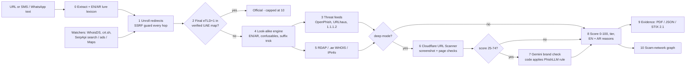

# CyberGuard - UAE scam-link intelligence

**ScamShield AI Hackathon - 42 Abu Dhabi × Abu Dhabi Police, November 2026 · Team CyberGuard**

CyberGuard checks a link, or a whole SMS / WhatsApp / email message, and answers three questions an Abu Dhabi Police analyst needs answered fast:

1. **Is it a scam?** A 0-100 risk score, a colour tier and a binary label.
2. **Why?** The top reasons, written in English and Arabic.
3. **What do we do?** A one-click police evidence pack (PDF + JSON + STIX 2.1) with the screenshot, WHOIS / hosting data, hashes, UTC + GST timestamps and the takedown contacts.

It also watches for threats **before** victims report them. It scans newly registered domains, fresh TLS certificates, and search results, ads and Google Maps listings for UAE brand look-alikes and fake helplines. A scam-network graph links domains that share infrastructure.

## Team CyberGuard

- **Saif Abdulla Alazazi** (Team Leader)
- **Hamdan Alebri**
- **Abdulrahman Saeed Alnaqbi**

## The problem

UAE scam messages mostly impersonate government payment services and banks: RTA / police traffic fines, Salik / Darb tolls, Parkin, UAE PASS, ICP visa / Emirates ID updates, Emirates Post parcels, and the big banks. Abu Dhabi Police handled **15,642 online-fraud cases in two years** ([The National, Oct 2025](https://www.thenationalnews.com/news/uae/2025/10/22/abu-dhabi-police-return-38-million-to-victims-of-online-fraudsters)). The UAE Cyber Security Council reports fraudulent messages **up about 35% in a year** ([Khaleej Times / WAM, Feb 2026](https://www.khaleejtimes.com/uae/cyber-security-council-warns-rise-fraudulent-messages)). One Smishing Triad campaign registered **730+ fake Dubai Police domains** in three months ([Resecurity](https://resecurity.com/blog/article/cybercriminals-impersonate-dubai-police-to-defraud-consumers-in-the-uae-smishing-triad-in-action)). Most of these domains live for less than a week ([Unit 42](https://unit42.paloaltonetworks.com/?p=161931)), and blocklists list a phishing URL about four days after it first appears. Aman receives reports and StaySafe gives a reputation verdict, but neither produces an *explained, bilingual, evidence-grade* analysis that names the impersonated UAE entity and is ready for takedown.

## The solution

CyberGuard is an ordered funnel. Cheap, deterministic layers decide most links. A verified map of UAE official domains protects real banks and government. The LLM is consulted only on borderline pages, and **code, not the LLM, makes the final call**. A layer that fails is skipped with a visible note and never counted as "safe". A link with no evidence either way is labelled **"No record - not verified"**, never "safe".

| # | Layer | What it does |
|---|---|---|
| 0 | Ingest | Extracts links from pasted text, including defanged (`hxxp`, `[.]`), full-width and Arabic-Indic forms. Applies an English/Arabic UAE lure lexicon and flags sender anomalies (for example a "government" SMS from +63 / +1). |
| 1 | Unroll | Follows redirects hop by hop (3xx, meta refresh, JS `location`), up to 10 hops, with an **SSRF guard on every hop**: public IPs only, peer IP re-checked after connect, ports 80/443, size and time limits. |
| 2 | Allowlist gate | Takes the eTLD+1 (Public Suffix List) of the **final** URL and compares it with 47 verified UAE entities, including legacy domains (e.g. `darb.itc.gov.ae` → `qmobility.ae`, `etisalat.ae` → `eand.ae`), plus the Tranco top-10k. Shorteners and free hosting platforms are never allowlisted. Unlisted `.gov.ae` domains are flagged for verification. Phone numbers injected into official-site queries are detected. |
| 3 | Threat feeds | OpenPhish, URLhaus, and the Cloudflare 1.1.1.2 malware/phishing DNS filter. |
| 4 | Look-alikes | UAE and global brand tokens, typosquats, leetspeak, Unicode TR39 confusables including Arabic-Indic digits, punycode / mixed scripts, Arabic brand names in IDNs, the `brand.gov.ae-xxx.top` / `com-` suffix trick, the `brand@real-host` userinfo trick, abused TLDs, brands and machine-generated names on free hosting, and e-mail-in-fragment. |
| 5 | Domain intel | RDAP age, registrar and abuse contact; port-43 WHOIS for `.ae`; IPinfo ASN / country; Cloudflare-proxy detection (so takedowns go to the right party); phishing-kit hosting ASNs. |
| 6 | Page capture (deep) | Cloudflare URL Scanner mobile screenshot + DOM, plus a direct mobile-UA fetch. Detects password / OTP / card / Emirates ID fields, Telegram-bot exfiltration, favicon hash, phone numbers vs the official helpline registry, brand names in page text, cloaking (CAPTCHA wall or empty page on a young brand domain), and the Cloudflare verdict. |
| 7 | AI brand check (deep, borderline only) | Gemini (`gemini-4-hydrogen`) names the brand a page claims and what it asks for. The prompt is hardened against injection: random-delimited untrusted blocks, URL as parsed parts, a fixed brand enum and JSON-schema output. **Code then applies the PhishLLM rule:** claimed brand ≠ final domain **and** credentials / payment / OTP requested. |
| 8 | Score | Weighted reason codes give a 0-100 score. Overrides: an official domain is capped at 10; a known-bad hit scores at least 90. Tiers follow Scameter's colours. Every reason has English and Arabic text. |
| 9 | Evidence pack | PDF (English + Arabic), JSON and STIX 2.1. Includes original and final URL, redirect chain, screenshot, WHOIS / registrar abuse contact, IP / ASN, UTC + GST timestamps, SHA-256 hashes, the impersonated brand and its official domain, and suggested actions (Aman 800 2626, registrar / Cloudflare abuse, CERT sharing). |
| 10 | Scam network | A networkx graph links domains through shared IP, nameserver, favicon, phone number, form target or redirect. Common infrastructure (Cloudflare anycast, big DNS hosts) is excluded. A new link to a known scam node adds `INFRA_LINK`. |
| W | Watchers | WhoisDS newly registered domains + crt.sh certificates filtered for UAE look-alikes, and a bilingual SerpApi pack for Google search, ads and Maps (fake helplines). Every hit is auto-scanned and shown in **Early warnings** with first-seen time and blocklist status. |

**Fast mode** (layers 0-5 + score) is about 1 s median per URL and is the default for batch and CLI. **Deep mode** adds layers 6-7 (up to ~45 s, mostly waiting for the Cloudflare scan).

### Architecture



## Evaluation (measured)

`python eval/run_eval.py` runs **fast mode** on `eval/validation.csv`. All numbers below were measured by the team on 24-25 Nov 2026 with the threshold **25** (score ≥ 25 → `fraud`, which equals the "Suspicious" tier and above).

**Validation set**

| Slice | Label | Count | Source |
|---|---|---|---|
| openphish | fraud | 2,317 available, 1,000 sampled for tuning, 1,317 held out | OpenPhish community feed, last 8 snapshots (20-24 Nov 2026) |
| smishing_ioc | fraud | 68 | Unit 42 smishing IOCs (Smishing Triad) + Resecurity Dubai Police IOCs |
| uae_synthetic | fraud | 30 | Hand-written UAE lure patterns. Reported separately, **never in the headline** |
| uae_official | legit | 221 | Real deep links crawled from 44 UAE bank and government sites, incl. login / payment pages |
| uae_business | legit | 105 | Real links from 50 legitimate UAE businesses **not** in our allowlist (noon, dubizzle, Emirates, ADNOC, SEHA, DHA…) |
| tranco | legit | 140 | Real deep links from 140 random Tranco top-10k sites |
| legit_hosting | legit | 25 | Well-known organisations' pages on github.io / blogspot |

RESULTS_PLACEHOLDER

**How to read this honestly**

- Weights were tuned on the 1,000-URL OpenPhish sample. The **held-out** 1,317 OpenPhish URLs were never looked at during tuning; their recall is the best estimate of performance on unseen phishing.
- With feeds ON, part of OpenPhish recall comes from the OpenPhish feed itself, so the **feeds OFF** rows are the honest measure of the detection layers alone.
- Official UAE domains are capped by design, so a 0% FPR on `uae_official` is expected. The `uae_business` slice (UAE sites **not** in the allowlist) is the real test that local legitimate sites are not flagged.
- This is our own validation set, not UAE ground truth. The hidden judging set will differ.

## Quick start

### Local

```bash
git clone https://github.com/Saif-Alazazi/cyberguard.git && cd cyberguard
python -m venv .venv && . .venv/bin/activate      # Windows: .venv\Scripts\activate
pip install -r requirements.txt
cp .env.example .env                              # add keys (all optional)
uvicorn app.main:app --port 8000                  # open http://localhost:8000
```

Other entry points:

```bash
python -m pytest                                   # unit tests (offline)
python cli.py urls.txt --mode fast --out results.csv
python eval/run_eval.py --no-feeds --limit 1000    # evaluation (needs internet)
python -m watchers.run_all --serp --export         # early-warning sweep
```

### Render (free plan)

1. Push this repo to GitHub (branch `master`).
2. In Render, choose **New → Blueprint** and select the repo. Render reads `render.yaml` (Python, free plan, `uvicorn app.main:app --host 0.0.0.0 --port $PORT`, health check `/health`).
3. Enter the secret environment variables when prompted: `GEMINI_API_KEY`, `CLOUDFLARE_ACCOUNT_ID`, `CLOUDFLARE_API_TOKEN`, `URLHAUS_AUTH_KEY`, `IPINFO_TOKEN`, `SERPAPI_KEY`. `CYBERGUARD_API_KEY` is optional: if set, it gates batch and watcher runs.
4. Deploy, then open `https://<service>.onrender.com/health`.

The free instance sleeps after 15 minutes idle, so the first request after sleeping takes ~1 minute. The SQLite database is in `/tmp` and resets on restart; the last watcher findings are re-seeded from `data/seed_scans.jsonl` and `data/early_warnings_seed.json`. No headless browser runs on the server: screenshots come from the Cloudflare URL Scanner API.

### API

| Method | Path | Purpose |
|---|---|---|
| POST | `/api/scan` | `{"input": "<url or message>", "mode": "fast\|deep", "sender": "+63…"}` → one result per link |
| POST | `/api/batch` | multipart CSV with a `url` column (≤500 rows) → CSV with label, score, tier, EN/AR reasons, case ID |
| GET | `/api/evidence/{case_id}?format=pdf\|json\|stix` | evidence pack |
| GET | `/api/graph` | scam-network nodes, edges and campaigns |
| GET | `/api/early-warnings` | watcher hits |
| GET | `/health` | liveness + which optional layers are configured |

## Tools, APIs and data

- **Python 3.12, FastAPI, httpx, dnspython, tldextract** (Public Suffix List snapshot bundled, no network fetch), **rapidfuzz, networkx, reportlab + arabic-reshaper + python-bidi, mmh3, phonenumbers**. Vanilla HTML/JS front end, vis-network for the graph.
- **APIs:** Cloudflare URL Scanner (screenshots, DOM, verdict), Cloudflare DNS-over-HTTPS (1.1.1.1 and 1.1.1.2 filter), Google Gemini `gemini-4-hydrogen` (optional), URLhaus, OpenPhish feed, rdap.org + aeDA port-43 WHOIS, IPinfo Lite, crt.sh, WhoisDS, SerpApi (Google search / ads / Maps).
- **Data (in `data/`):** `uae_brands.json` (47 UAE entities: English + Arabic names, official and legacy domains, tokens, helplines tagged `src` / `unverified`), `global_brands.json`, `shorteners.txt`, `free_hosting.txt`, `abused_tlds.txt` (Unit 42 / Resecurity), `lures_en_ar.json` (bilingual lexicon; source-quoted phrases weighted higher), `confusables_min.json` (Unicode TR39 subset), `tranco_top10k.txt` (Tranco list Q2464), and the IBM Plex Sans Arabic font (OFL).

## Limitations (stated plainly)

- **Geo-cloaking:** UAE-geofenced kits can show our scanners an empty page. We score emptiness or a CAPTCHA on a young brand-keyword domain as a risk, but we do not scan from UAE mobile networks.
- **CAPTCHA / Turnstile walls** are flagged, not solved.
- **Compromised legitimate sites** hosting a phishing page deep in a path are hard for fast mode (URL-only). Deep mode catches them when the page is live.
- **`.ae` domain age:** aeDA WHOIS does not publish a creation date, so `.ae` age shows as unknown.
- **The LLM** can misjudge benign pages and is exposed to prompt injection, so it only names the brand; code decides, and only for borderline scores.
- **Allowlist and helpline registry** need ongoing input from the entities themselves. Several helplines are marked `unverified` and are not treated as known-good.
- **Search / ads / Maps coverage** is limited by the free SerpApi quota (250 searches a month). Maps branch phone numbers that are not in the registry are flagged for analyst review, not as confirmed fakes.
- **Free-hosting heuristics** ("machine-generated site name") were measured on only 25 legitimate hosted pages; legitimate preview deployments with random names could be flagged as Suspicious.
- **Ephemeral storage on Render free:** scan history resets on restart.
- **Takedowns:** CyberGuard builds the takedown pack; it does not execute takedowns (police authority is required).
- **Measured numbers** come from our own validation set, not UAE ground truth.

## Roadmap to an Abu Dhabi Police pilot

1. **Analyst triage (month 1-2):** Aman intake pastes reported messages into CyberGuard. The AI pre-scores; only a police analyst can apply the public "confirmed scam" label (the Scameter / ScamShield model). Measure precision, recall and time-to-takedown on real reports.
2. **Citizen check (month 3):** a public "check before you click" page plus a WhatsApp / Telegram bot that returns the bilingual verdict card.
3. **Always-on early warning (month 4+):** continuous CT and new-domain monitoring for UAE brands from a UAE-hosted node (also solves geo-cloaking). Brand owners confirm their domains and helplines. Feeds go to TDRA / aeCERT, registrars and APWG eCX.

## Credits

- Detection design follows the team's research report (PhishLLM / KnowPhish reference-based detection, NOKEScam cheap-first ordering, Scameter tiers, InjectDefuser prompt hardening).
- **Reused from the team's earlier FraudLand prototype** (adapted): URL normalisation + SSRF guard and IP-checked fetch (`app/pipeline/netsafe.py`), the HTML inspector (`app/pipeline/page.py`), the inverted-index infrastructure-correlation idea (`app/graph.py`, `app/store.py`), RDAP / crt.sh collectors (`app/pipeline/domain_intel.py`, `watchers/nrd_ct.py`), and the API-key check, rate-limit and security-header middleware (`app/main.py`).
- Data: OpenPhish, URLhaus (abuse.ch), Tranco, Unicode confusables, Unit 42 and Resecurity public IOCs, IPinfo Lite (CC BY-SA 4.0), IBM Plex Sans Arabic (SIL OFL).
